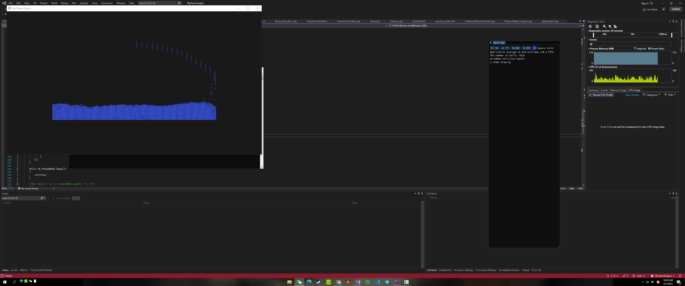
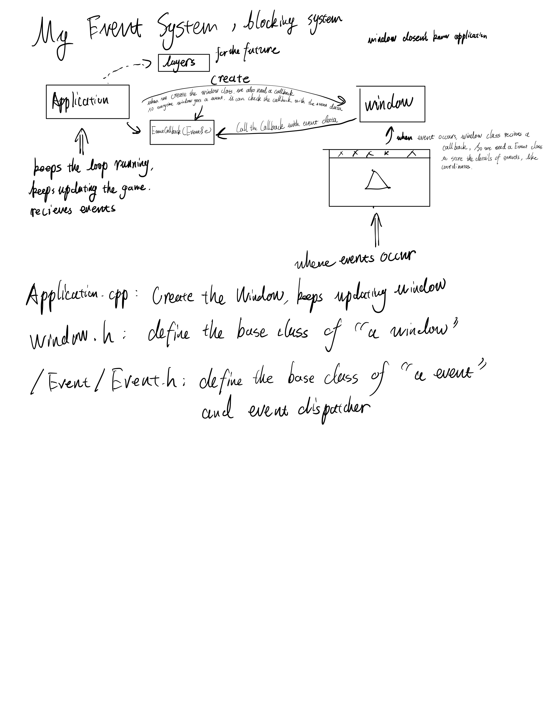
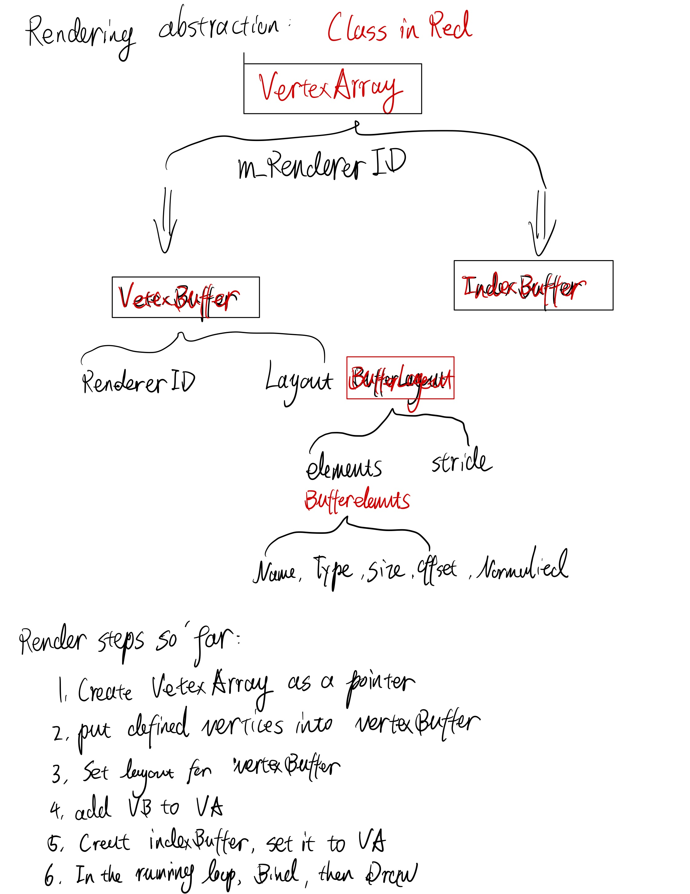
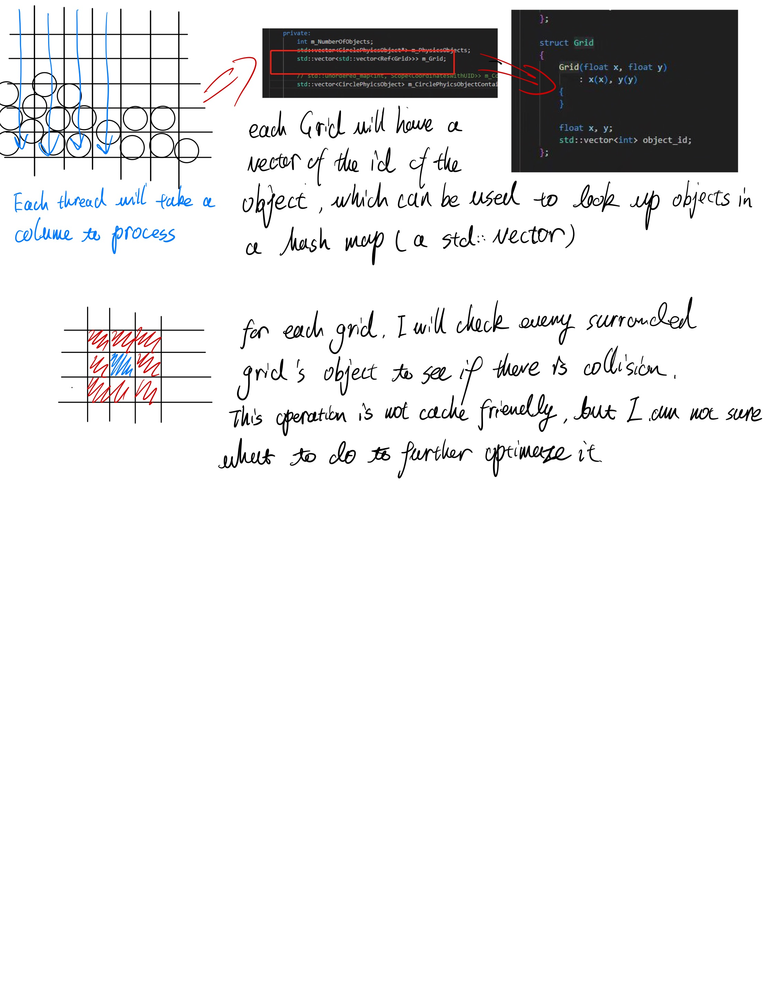

# MyGameEngine
Studying Hazel Engine coded by The Cherno and Physics simulation study by myself

****
## So Far I Got and TODO:
1, collision detection with circle and high performance simulation


2, GJK and EPA implemented but not stable

3, Soft body with spring and mass model/Pressure vloume model

****
## How to Set the VS Solution Up with Premake
Right now only support Windows, havent tried with Mac and Linux
Make sure you have Visual Studio newer than 2019, or you can change the version of VS in GenrateProjects.bat

pull or clone the project
```
git clone
```
pull the submodules
```
git pull --recurse-submodules
```

Then click GenrateProjects.bat to generate the solution
****
## Engine's Dev Log

Event system anslysis at 7/10


Render Abstraction at 7/10


7/23/2023
Starts my own creation, will keep going with Hazel video but mainly will foucs on Physics now.

Today's work: elastic collision with 10 balls
Todo: 
1, need to create better API for the scene, like how many balls/width and height etc
2, improve the collision detection function, now is O(n^2), which is stupid
3, Add debug tools and Frame rate 

7/24/2023
Done with basic API. Right now with 500 balls the fps is only around 60
A known bug: moving the window will cause timestep to grow into a unusual number which can lead to unknown behavior. 

7/25/2023
Fix the bug with timestep but it feels like the simulation now is depenedent on the frame rate. Great, another bug.
Roughly done with the grid optimazition, it is a Space Division optimazition. With 500 balls, the fps can now be over 120 now. However the frame rate can be influeneced by how tight balls are to each other. 
Next step I will see if I can further optimaze the grid, or I will see if I can implement Sort and Sweep or AABB

7/26/2026
Fixed a bug on the edge
Roughly done with mutithread optimazition. With 2000 balls, single thread can't hold to do anything. With 20 threads, it can be around 50fps. I think I should try another way to see the improvement of the optimazition. 
I studyed for SIMD today and realized that the best way to use SIMD is to use mutithread first. I barely have any vector calculation in the current scene and it just seems not worth it to implement SIMD. I will see if I can further improve the performance of this scene tomorrow. If not, I will proceed to the next scene: Spring or Pendulum

7/27/2023
I realized that, neither of Spring or Pendulum shoud be my piority right now so I decided to try to implement Minkowski sum and GJK for collision detection for complex 2D polygon

7/30/2023
Done with GJK for collision detection, now in theroy any convex will be able to detect collision. I just need to find a better to resolve the collision, which I think I will have to implement rotation first

8/2/2023
Added the rotation for square and realized the performance of the circle collision detection has a huge flaw so decided to add sub-steps to smooth things a bit. But it couldnt hold much more balls in the scene. On youtube there is this one guy who can do the collision scene for 3000 balls with 10 sub-steps. Damn. 

8/6/2023
Feels like I have done everything I can with this scene and I just cant figure out a way to further improve this. 

8/8/2023
Basic implementation of the balls collision scene
Optimaztion methods:
    1, Space division, use m_Grid in the scene to store info of postion of balls to reduce the number of collision check
    2, Use Thread pool to assgin tasks to different thread, go through m_Grid colume by colume for task-balancing
    3, Use std::vector for cache friendly, it is necessary because for every frame, grid's info needs to update with the new position of the balls and therefore need to go through balls one by one in order. In this case, cache firendly is highly in need.
    4, Substep for soomther perfermance 
    5, Use Verlet intergation, faster performance than classic Newton

Optimaztion Abstraction:


8/15/2023
Trying to implement EPA, doesnt look like it can be stable, need more work. 

1/12/2024
Fluid stable without gravity and low performance

11/7/2026
Coming back to this project after a long break. Set up CMake and VS Code build/debug configurations so the project can be built with MSVC Build Tools without the Visual Studio IDE. Restored missing submodules and fixed compatibility with the current compiler.

Separated the ball collision demo from the particle fluid demo in the Settings scene selector. The ball scene now starts with 10000 balls in a 260 x 160 area, with gravity and mouse spawning. Hold the left mouse button to add balls with the same initial speed magnitude and random directions.

****
## Collision Optimization Revisit

The ball scene currently uses single-threaded grid collision detection and fixed 480 Hz Verlet updates. The old column-based thread pool code is still present but is not enabled. The following changes were tested in Release builds.

1, Squared distance checks and reuse of collision calculations

Previously, collision detection compared the distance between two balls with their diameter, which required a square root for every candidate pair. It now compares `dot(delta, delta)` with `diameter * diameter`. A square root is only needed when resolving an actual overlap.

The Verlet collision response also calculates the distance, direction and position correction once and reuses them for both balls, instead of repeatedly calculating the same values.

Observed result: the rough interactive limit went from around 8000 balls to around 10000 balls. There was no performance log before this change, so this is an observation rather than a measured speedup.

2, Remove duplicate collision pair checks

Previously, a pair could be processed as both A -> B and B -> A. Within the same cell, only pairs with the second particle ID greater than the first are now checked. Between cells, only the right neighbor and the three neighbors in the next row are visited. This covers each unordered candidate pair once.

Observed result: in the 10000-10999 ball range, average physics step time dropped from about 1.96 ms to 1.16 ms, roughly 41% less time. The earlier build fell to about 444 physics steps/s at 10431 balls, while the deduplicated build still maintained about 480 steps/s at 12772 balls.

Known issue: this also removes repeated position corrections, so the solver does less work per pair and dense piles can become less stable. The speedup is not a comparison at equal solver quality. Abnormal acceleration and pile stability still need work.

3, Contiguous grid memory layout

The original grid used `vector<vector<shared_ptr<Grid>>>`, with a separate `vector<int>` of particle IDs in each cell. It now stores all cells in one contiguous array and all particle IDs in another contiguous array. Each cell references a range in the shared particle ID array.

Grid rebuilding uses three stages: count particles per cell, calculate prefix offsets, then scatter particle IDs into their cell ranges. The scatter preserves the previous particle order within each cell, so collision traversal and solving order stay the same.

The goal is to reduce pointer chasing and scattered memory accesses. The tradeoff is additional linear scans during rebuilding, so this is not guaranteed to improve every workload.

Observed result after expanding the scene:

| Ball count range | Before contiguous grid | After contiguous grid |
| --- | --- | --- |
| 10000-10999 | 0.93 ms/step | 0.98 ms/step |
| 12000-12999 | 1.27 ms/step | 1.30 ms/step |
| 14000-14999 | 1.48 ms/step | 1.20 ms/step |

These were interactive runs with different particle distributions, not a controlled benchmark. The results are mixed and do not establish a consistent speedup from the memory layout change. In the latest run, 17487 balls took about 1.93-2.10 ms/step and mostly maintained 480 steps/s, falling to about 471 near the end.

****
## Performance Measurement

FPS alone was not enough to compare these changes. Settings now displays average physics step time and actual completed physics steps per second, updated about once per second. Physics timing excludes drawing. The ball scene target is 480 steps/s; lower sustained throughput means simulation time is falling behind real time.

Every run writes a separate CSV under `Sandbox/logs/`, recording build ID, build configuration, scene, ball count, frame time, FPS, physics step time, physics throughput and spawn settings. Logs are flushed each sampling interval and ignored by Git.

At 480 Hz, the total wall-clock budget is about 2.083 ms per physics step, including the share needed for rendering and other work. Timing comparisons should use Release builds with similar particle counts and distributions. Scene size, pile density and solver stability all affect the results.

Next steps:
1, Add reproducible benchmarks with fixed random seeds, fixed particle counts and uniform/dense/piled distributions. Time grid rebuilding and collision solving separately.
2, Improve overlap spawning, boundary response and contact stability. Compare the current position Verlet implementation with semi-implicit Euler plus contact impulse solving at comparable simulation quality; see TODO.md.
3, Fix thread pool completion tracking and concurrent particle writes before enabling multithreaded collision solving again.
